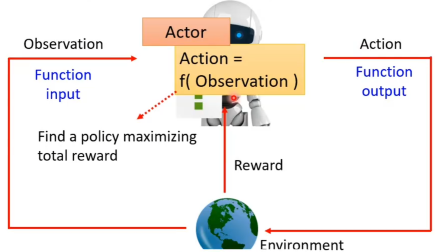

# 什么是RL

机器学习的核心是找到一个函数，通过寻找最佳的参数，让函数能够输出更精准的预测，强化学习的核心也是一样，找到最佳的函数，通过当前的状态，判断出最优的行动      

这个函数就是Actor，在强化学习中，Environment为Actor提供输入，输入当前环境的状态，Actor输出一个action，来改变环境的状态，在二者互动的过程中，Environment会给Actor提供reward，Actor的目标就是使得整个过程中获得的reward的总和最大      

# 强化学习构建的三个步骤

## 1. 确定函数中的未知数
在强化学习中，actor通常是一个network，要被学习出的未知数就是network中的参数
## 2. 定义损失函数
actor与enviornment不断交互直到结束的整个过程称为episode，强化学习的目标是最大化整个episode产生的reward的总和，所以把-(total reward)作为损失函数，使它不断变小即可
## 优化函数
以total reward来优化actor的参数，但是在rl中，随机性是很大的，在相同的状态下，actor选取的action是随机的，相同状态选取相同action，获得的reward也可能是随机的，所以不能用一般机器学习的方法，来优化network中的参数

# 策略梯度Policy Gradient
## 如何控制actor选择什么action？
假如状态为s时，我们希望actor选择$a_1$，就可以通过把损失函数设置为交叉熵的形式，最小化损失函数即可      
更进一步，在RL中，可以对每个动作的权重不仅设置为0/1，可以设置成不同的数，根据正负和数值大小来评价选取该动作的优劣以及优劣等级，对每个动作额外计算出一个参数A，损失函数设置为$L=\sum A_ie_i$，最终求得使L最小化的参数
##
知道了如何控制actor，我们还需要知道哪些action是好的，是我们想要的，以及他们的参数A应该怎么计算    

## 怎么计算$A_i$
在选取了一个action之后，environment会给出一个reward，reward越大，说明当前的动作可能就越好，所以，我们就可以根据reward来设置$A_i$
但是不能只根据当前一次的reward就来评判，因为很多时候，放弃眼前即时的reward，才能最终拿到大结果，比如在fps游戏，先瞄准再射击比直接射击更好，但瞄准阶段是通常不会有奖励，所以如果只看当前reward的话，Actor可能更倾向于直接射击，进而训练成一个莽夫 
所以可以在整个episode结束之后，把当前s之后的所有获得的reward加起来作为评价这个action的指标，但也不能直接相加，因为距离当前action比较远的状态，可能和当前的选择关系不大，不能完全把功劳归功于当前的选择，所以我们每往后一步获得的reward乘以一个折扣因子再去求和。
此时还面临一个问题，选取不同的动作，可能最终获得的A都是正的，尽管大小有差异，模型依然会鼓励采取A为正数的action，所以，还需要对A进行正则化。
## Policy Gradient的具体操作步骤
1. 初始化参数$\theta$
2. 采取T次循环:
    - 使用$\theta_{i-1}$与环境交互，生成一个完整的trajectory并获取数据
    - 计算每个动作的权重$A_i$
    - 计算损失，并更新得到$\theta_i$

